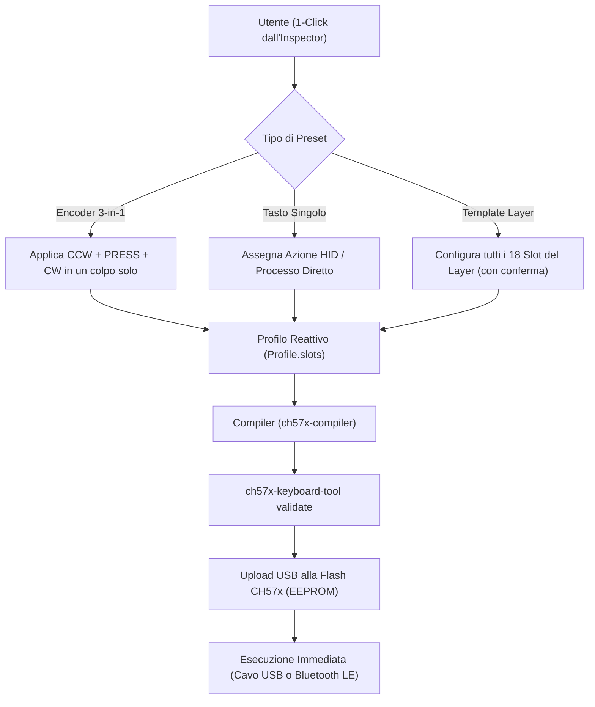

# VortexDeck — Guida e Documentazione Tecnica del Sistema Preset 1-Click

Questo documento descrive in dettaglio l'architettura, la logica di dominio, i token hardware e il codice sorgente del sistema di **Preset 1-Click** implementato in **VortexDeck (CH57x Studio)** per manopole rotative (Encoder 3-in-1), tasti singoli di produttività e interi Template di Layer.

---

## 1. Architettura Generale dei Preset

Il sistema di preset di VortexDeck permette all'utente di configurare comportamenti complessi (sia comandi hardware HID nativi memorizzati nella memoria flash della tastiera, sia automazioni host memorizzate nel database locale) con un singolo click dall'Inspector, senza dover impostare manualmente ogni singolo evento né dover creare file `.bat` su disco.



### Vantaggi Chiave:
1. **Nessun File `.bat` su disco**: tutti i comandi da terminale sono salvati come definizioni atomiche strutturate in `profile.json` (`ExecProcessAction`).
2. **Nessun Allarme Antivirus**: gli script non usano PowerShell offuscato o Base64, bensì invocazioni dirette conformi alle policy di sicurezza di Windows (`cmd.exe /c start cmd.exe /k agy` o `wt.exe -d . agy`).
3. **100% Compatibilità Hardware**: tutti i token generati validano con esito positivo (`config is valid 👌`) contro il tool ufficiale upstream `ch57x-keyboard-tool`.
4. **Funzionamento sia USB che Bluetooth**: le azioni HID native configurate dai preset operano sia via cavo che in modalità wireless Bluetooth LE.

---

## 2. Preset Encoder 3-in-1 (Manopole Rotative)

Quando si seleziona una delle due manopole nell'Inspector, VortexDeck visualizza la griglia dei **Preset 3-in-1**. Ciascun preset assegna simultaneamente tutti e 3 gli eventi hardware dell'encoder:
- `Ccw`: Rotazione Antioraria (sinistra)
- `Press`: Click a Pressione della manopola
- `Cw`: Rotazione Oraria (destra)

| Preset | CCW (Sinistra) | PRESS (Click) | CW (Destra) | Utilizzo Tipico |
|---|---|---|---|---|
| **Volume + Mute** | `volumedown` (Vol -) | `mute` (Mute) | `volumeup` (Vol +) | Regolazione audio di sistema con silenzioso rapido |
| **Luminosità + Play** | `macbrightnessdown` (Lum -) | `play` (Play/Pausa) | `macbrightnessup` (Lum +) | Regolazione luminosità Surface/monitor e controllo multimediale |
| **Zoom + Reset 100%** | `ctrl-minus` (Zoom -) | `ctrl-0` (100%) | `ctrl-equal` (Zoom +) | Zoom fluido in IDE (VSCode/Cursor), browser e visualizzatori CAD |
| **Scorri Tab (IDE/Browser)** | `ctrl-shift-tab` (Tab SX) | `ctrl-w` (Chiudi Tab) | `ctrl-tab` (Tab DX) | Navigazione tra schede di lavoro e chiusura rapida |
| **Undo / Redo / Salva** | `ctrl-z` (Undo) | `ctrl-s` (Salva) | `ctrl-y` (Redo) | Pipeline di editing continuo senza staccare le mani dalla tastiera |
| **Desktop Virtuali Win11** | `win-ctrl-left` (Desk SX) | `win-tab` (TaskView) | `win-ctrl-right` (Desk DX) | Navigazione istantanea tra desktop virtuali di Windows 11 |
| **Scroll Mouse + Play** | `wheelup` (Scroll SU) | `play` (Play/Pausa) | `wheeldown` (Scroll GIU) | Lettura documenti lunghi e scrolling pagine web |

---

## 3. Preset Rapidi Produttività (Tasti Singoli)

Quando si seleziona uno dei 12 tasti meccanici della matrice 4x3, l'Inspector presenta una serie di chip cliccabili che impostano direttamente l'azione ottimizzata con label e colorazione standard:

### A. CLI & Strumenti di Sviluppo (Processi Host `CMD`)
- **Apri `agy` (Prompt)**: lancia `agy` nel terminale classico (`cmd.exe /c start cmd.exe /k agy`) nella cartella del progetto.
- **Apri `agy` (Windows Terminal)**: lancia `agy` in Windows Terminal moderno con tab integrata (`wt.exe -d . agy`).
- **Windows Terminal**: apre una nuova tab di Windows Terminal pulita (`wt.exe`).
- **Gestione Dispositivi (`devmgmt.msc`)**: apre istantaneamente Gestione Dispositivi Windows via MMC per diagnostica porte COM, USB e Bluetooth.

### B. Scorciatoie di Sistema e Utilità Windows 11 (HID Nativo)
- **Screenshot Area (`win-shift-s`)**: avvia lo strumento di cattura rettangolare di Windows.
- **Cronologia Appunti (`win-v`)**: apre il visualizzatore storico della clipboard multilivello di Windows.
- **Mute Microfono Win11 (`win-alt-k`)**: attiva o disattiva il microfono a livello di sistema operativo.
- **Task Manager (`ctrl-shift-escape`)**: apre immediatamente Gestione Attività.
- **Sposta su Altro Monitor (`win-shift-right`)**: sposta la finestra attiva al monitor adiacente.

### C. Clipboard ed Editing Rapido
- **Copia** (`ctrl-c`), **Incolla** (`ctrl-v`), **Taglia** (`ctrl-x`)
- **Undo** (`ctrl-z`), **Redo** (`ctrl-y`), **Salva** (`ctrl-s`), **Cerca** (`ctrl-f`)

---

## 4. Template di Intero Layer (18 Slot in 1-Click)

VortexDeck permette di configurare un intero Layer (12 tasti e 2 manopole rotative) con un solo click. Se il layer contiene già dei tasti configurati, l'interfaccia richiede una **conferma esplicita** per proteggere il lavoro dell'utente da sovrascritture accidentali.

### Template 1: "Coding & Produttività AI"
Pensato per sviluppatori, data scientist e power user di terminali AI come `agy`.
- **Encoder 0 (Superiore)**: `Volume + Mute` (`Ccw: volumedown`, `Press: mute`, `Cw: volumeup`)
- **Encoder 1 (Inferiore)**: `Zoom + Reset 100%` (`Ccw: ctrl-minus`, `Press: ctrl-0`, `Cw: ctrl-equal`)
- **Matrice Tasti (4x3)**:
  - R1: `agy (cmd)` | `Terminal (wt)` | `Screen (Win+Shift+S)` | `Appunti (Win+V)`
  - R2: `DeviceMgr` | `TaskMgr (Ctrl+Shift+Esc)` | `Taglia (Ctrl+X)` | `Copia (Ctrl+C)`
  - R3: `Incolla (Ctrl+V)` | `Undo (Ctrl+Z)` | `Redo (Ctrl+Y)` | `Salva (Ctrl+S)`

### Template 2: "Window & Multi-Monitor Tiling"
Pensato per il window management veloce e la produttività multi-schermo.
- **Encoder 0 (Superiore)**: `Scorri Tab (IDE/Browser)` (`Ccw: ctrl-shift-tab`, `Press: ctrl-w`, `Cw: ctrl-tab`)
- **Encoder 1 (Inferiore)**: `Desktop Virtuali Win11` (`Ccw: win-ctrl-left`, `Press: win-tab`, `Cw: win-ctrl-right`)
- **Matrice Tasti (4x3)**:
  - R1: `Metà SX (Win+←)` | `Massimizza (Win+↑)` | `Metà DX (Win+→)` | `Minimizza (Win+↓)`
  - R2: `Monitor DX (Win+Shift+→)` | `Monitor SX (Win+Shift+←)` | `TaskView (Win+Tab)` | `Desktop (Win+D)`
  - R3: `Menu Finestra (Alt+Space)` | `Nuovo Desk (Win+Ctrl+D)` | `Chiudi Desk (Win+Ctrl+F4)` | `Esplora File (Win+E)`

---

## 5. Codice Sorgente di Riferimento

### Modulo Preset (`crates/ui/src/presets.rs`)
Il modulo isola e tipizza in modo rigoroso tutte le definizioni dei preset:

```rust
// Estratto da crates/ui/src/presets.rs

pub fn apply_encoder_preset(
    profile: &mut Profile,
    layer: LayerIndex,
    encoder_index: u8,
    preset: &EncoderPresetDef,
) {
    let ccw_slot = SlotId {
        layer,
        control: ControlId::Encoder {
            index: encoder_index,
            event: EncoderEvent::Ccw,
        },
    };
    let press_slot = SlotId {
        layer,
        control: ControlId::Encoder {
            index: encoder_index,
            event: EncoderEvent::Press,
        },
    };
    let cw_slot = SlotId {
        layer,
        control: ControlId::Encoder {
            index: encoder_index,
            event: EncoderEvent::Cw,
        },
    };

    let (ccw_b, press_b, cw_b) = (preset.make_bindings)();

    if let Some(cfg) = profile.slots.get_mut(&ccw_slot.global_index()) {
        cfg.binding = ccw_b;
        cfg.label = preset.ccw_label.to_string();
    }
    if let Some(cfg) = profile.slots.get_mut(&press_slot.global_index()) {
        cfg.binding = press_b;
        cfg.label = preset.press_label.to_string();
    }
    if let Some(cfg) = profile.slots.get_mut(&cw_slot.global_index()) {
        cfg.binding = cw_b;
        cfg.label = preset.cw_label.to_string();
    }
}
```

### Integrazione nell'Inspector (`crates/ui/src/inspector.rs`)
La UI espone i preset in modo contestuale:
- Selezionando un Encoder: compaiono i bottoni dei **7 Preset 3-in-1**.
- Selezionando un Tasto: compaiono i chip dei **Preset Rapidi Produttività**.
- In assenza di selezione o nella card dedicata: compaiono i pulsanti per applicare i **Template di Intero Layer**, con guardia di conferma sovrascrittura.

---

## 6. Procedura per Scrivere i Preset sulla Tastiera Fisica

1. **Seleziona o Applica un Preset**:
   - Clicca su un Encoder o su un Tasto nel visualizzatore Macropad a sinistra.
   - Clicca sul preset desiderato (es. *Volume + Mute*, *Luminosità + Play*, *Coding & Produttività AI*).
2. **Collega il Cavo USB**:
   - Assicurati che il Macropad sia connesso tramite cavo USB Type-C (la scrittura della flash richiede la connessione fisica USB con driver WinUSB/UsbDk).
3. **Scrittura Hardware (Upload)**:
   - Clicca sul pulsante **`Applica & Scrivi (Upload)`** nella barra superiore.
   - VortexDeck convalida la configurazione, genera il file YAML compatibile al 100% con `ch57x-keyboard-tool`, e programma la memoria flash del microcontrollore CH57x.
4. **Verifica Operativa**:
   - Scollega il cavo e usa la tastiera in Bluetooth, oppure mantienila collegata via cavo USB: le manopole e i tasti risponderanno all'istante con zero latenza.
