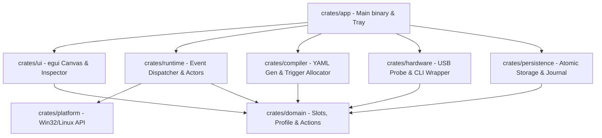

<div align="center">

# 🎛️ VortexDeck (CH57x Studio)

### *High-Performance Visual Configurator & Host Automation Engine for CH57x Macropads*

[](https://github.com/KojiroXor/ch57x-studio/actions/workflows/ci.yml)
[](https://github.com/KojiroXor/ch57x-studio)
[](https://www.rust-lang.org/)
[-007AFF)](https://github.com/emilk/egui)
[-success)](#-hardware-support)
[](LICENSE)

*VortexDeck brings modern, high-precision customization to popular CH57x-based USB/Bluetooth Macropads (12 mechanical keys + 2 rotary push-encoders + 3 LED indicators across 3 hardware layers = 54 fully programmable slots).*

</div>

---

## 🌟 Highlights

- **Dual-Engine Architecture**:
  - **⚡ Hardware Flash**: Compiles byte-exact YAML mappings and programs the on-board flash memory via low-level USB commands (`ch57x-keyboard-tool`). Works standalone on Bluetooth/cable without running any software.
  - **🖥️ Native Host Automation**: Intercepts unassigned phantom triggers (F13..F24 across 5 modifier banks) to drive deep Windows automation: window tiling, multi-monitor workspace restore, clipboard operations, and system brightness.
- **💎 Apple Liquid Glass UI**: Custom vector canvas built with `egui` and Gouraud-shaded mesh lighting, subtle translucent acrylic glass, and responsive animations.
- **🔄 Drag-and-Drop Key Swapping**: Reorganize your layout by clicking and dragging keys on the visual macropad canvas with immediate visual feedback (floating glass ghost & green drop target).
- **🎚️ Native Windows Screen Brightness**: Custom WMI & Gamma Ramp brightness engine for rotary knobs—smoothly dims or boosts laptop screens (Surface, ThinkPad) and external displays without relying on macOS-specific keycodes.
- **⚡ 1-Click Productivity Presets**: Pre-configured 3-in-1 rotary encoder suites (Volume+Mute, Zoom+Reset, IDE Tab Scroll, Virtual Desktops, Undo/Redo) and rapid button chips (`agy`, Windows Terminal, Device Manager, Win+V, Screenshot).
- **📋 1-Click Layer Templates**: Populate all 18 slots of any layer at once with tested templates like **Coding & AI Productivity** or **Window & Multi-Monitor Tiling**.
- **🛡️ Crash-Resistant State & Audit**: Transactional atomic storage (`.tmp` -> rename), deployment journal state machine, executable trust-store hash validation, and background system tray daemon.

---

## 📐 Hardware Layout & Matrix

```
┌───────────────────────────────────────────────────────────────┐
│                     VortexDeck Macropad                       │
│                                                               │
│   ┌──────┐ ┌──────┐ ┌──────┐ ┌──────┐       ( LED 1 )   ╭───╮ │
│   │ K01  │ │ K02  │ │ K03  │ │ K04  │                   │ E1│ │
│   └──────┘ └──────┘ └──────┘ └──────┘       ( LED 2 )   ╰───╯ │
│   ┌──────┐ ┌──────┐ ┌──────┐ ┌──────┐                   Encoder1
│   │ K05  │ │ K06  │ │ K07  │ │ K08  │       ( LED 3 )   ╭───╮ │
│   └──────┘ └──────┘ └──────┘ └──────┘                   │ E2│ │
│   ┌──────┐ ┌──────┐ ┌──────┐ ┌──────┐                   ╰───╯ │
│   │ K09  │ │ K10  │ │ K11  │ │ K12  │                   Encoder2
│   └──────┘ └──────┘ └──────┘ └──────┘                         │
│       4 Columns x 3 Rows = 12 Buttons             2 Encoders  │
└───────────────────────────────────────────────────────────────┘
```

| Component | Quantity | Events per Layer | Total Physical Slots (3 Layers) |
| :--- | :---: | :---: | :---: |
| **Mechanical Buttons** | 12 | 12 Press events | 36 slots |
| **Rotary Encoder 1** | 1 | 3 events: CCW (left), Push, CW (right) | 9 slots |
| **Rotary Encoder 2** | 1 | 3 events: CCW (left), Push, CW (right) | 9 slots |
| **Total Configurable**| **14 Controls** | **18 Slots / Layer** | **54 Programmable Slots** |

---

## 🚀 Quick Start

### Option A: Download Pre-built Release (Recommended)
1. Download the latest `VortexDeck-Windows-x64.zip` from [GitHub Releases](https://github.com/KojiroXor/ch57x-studio/releases).
2. Extract the archive and ensure `dist/VortexDeck/bin/ch57x-keyboard-tool.exe` is present.
3. Install the low-level USB driver [UsbDk (x64)](https://github.com/daynix/UsbDk/releases) if you intend to flash hardware memory.
4. Launch `vortexdeck.exe`.

### Option B: Build from Source
Ensure you have the Rust toolchain installed:

```powershell
# Clone the repository
git clone https://github.com/KojiroXor/ch57x-studio.git
cd ch57x-studio

# Run automated tests across all 8 crates
cargo test --workspace

# Build the release bundle
cargo build --release --bin vortexdeck

# Package into dist/ folder
powershell -ExecutionPolicy Bypass -File packaging/windows/build_release.ps1
```

---

## 🕹️ CLI & Background Daemon Flags

```powershell
# Run Device Doctor diagnostics (USB enumeration, UsbDk driver verification)
.\vortexdeck.exe --doctor

# Run in background daemon mode (starts hidden directly into the System Tray)
.\vortexdeck.exe --background

# Custom profile path
.\vortexdeck.exe --profile "C:\path\to\custom_profile.json"
```

---

## 🏗️ Crates & Architecture

VortexDeck is structured as a decoupled, clean-architecture Cargo workspace:



| Crate | Role | Highlights |
| :--- | :--- | :--- |
| [`ch57x-domain`](crates/domain) | Pure Domain Model | 54 Slot IDs, 60 PhantomTriggers (F13..F24 in 5 banks), Action definitions, validation logic. Zero platform dependencies. |
| [`ch57x-platform`](crates/platform) | OS Abstraction | Win32 Per-Monitor DPI v2, `DwmGetWindowAttribute` shadow compensation, UIPI check, WMI/Gamma brightness, `WM_HOTKEY` pump. |
| [`ch57x-hardware`](crates/hardware) | Device Communication | Subprocess wrapper around `ch57x-keyboard-tool` (stdin pipe, `CREATE_NO_WINDOW`), Win32 PnP USB probing (VID 0x1189). |
| [`ch57x-compiler`](crates/compiler) | Configuration Compiler | Deterministic trigger allocator, byte-exact YAML generator, SHA-256 diffing to prevent unnecessary hardware re-flashing. |
| [`ch57x-persistence`](crates/persistence) | Safe Storage | Atomic file writes (`.tmp` -> replace), transactional deployment journal state machine, executable hash trust store. |
| [`ch57x-runtime`](crates/runtime) | Host Engine | Real-time trigger routing, multi-window tiling actor, workspace restore, async macros with foreground focus guard. |
| [`ch57x-ui`](crates/ui) | Graphical Interface | Custom egui Liquid Glass canvas, drag-and-drop key swap, knob dials, inspector cards, device calibration wizard. |
| [`ch57x-studio`](crates/app) | Orchestration & Entry | CLI flags, coordinator loop, native Windows System Tray with context menu, single-instance mutex. |

---

## 🎨 Presets & Productivity Library

### Encoder 3-in-1 Suites
Configure rotation left (CCW), central push button, and rotation right (CW) with one click:
- 🔊 **Volume & Mute**: `CCW: VolumeDown` | `Push: Mute` | `CW: VolumeUp`
- ☀️ **Display Brightness & Play**: `CCW: Brightness -5%` | `Push: Play/Pause` | `CW: Brightness +5%`
- 🔍 **Zoom & Reset**: `CCW: Ctrl+-` | `Push: Ctrl+0` | `CW: Ctrl+=`
- 📑 **IDE / Browser Tabs**: `CCW: Ctrl+Shift+Tab` | `Push: Ctrl+W` | `CW: Ctrl+Tab`
- ↩️ **Undo / Redo / Save**: `CCW: Ctrl+Z` | `Push: Ctrl+S` | `CW: Ctrl+Y`
- 🪟 **Virtual Desktops (Win11)**: `CCW: Win+Ctrl+Left` | `Push: Win+Tab` | `CW: Win+Ctrl+Right`
- 🖱️ **Mouse Scroll & Play**: `CCW: WheelUp` | `Push: Play/Pause` | `CW: WheelDown`

### Rapid Button Presets
- 🤖 **Launch `agy` (DeepMind AI CLI)**: Spawns terminal at current workspace.
- 💻 **Windows Terminal**: Opens `wt.exe`.
- ⚙️ **Device Manager**: Opens `devmgmt.msc` for USB/COM device inspection.
- ✂️ **Screen Snipping**: `Win+Shift+S`.
- 📋 **Clipboard History**: `Win+V`.
- 🎙️ **Microphone Mute (Win11)**: `Win+Alt+K`.
- 📊 **Task Manager**: `Ctrl+Shift+Esc`.
- 🖥️ **Move Window to Next Monitor**: `Win+Shift+Right`.

---

## 🛡️ Anti-Virus & Windows Defender Transparency

When compiling or running VortexDeck for the first time, Windows Defender or heuristic AV tools may flag custom automation binaries. Here is the technical explanation:

1. **Global Low-Level Keyboard Hooks**: VortexDeck intercepts F13..F24 hotkeys via standard Win32 `RegisterHotKey` to allow hardware buttons to trigger Windows workflows without stealing foreground focus.
2. **Direct USB Device Communication**: `ch57x-keyboard-tool` communicates with the USB HID/Vendor endpoint using `UsbDk` kernel filters.
3. **Unsigned Executables**: Locally compiled open-source Rust binaries lack a paid EV Code Signing Certificate.

> [!NOTE]
> All code is 100% open source, free of telemetry, and does not require elevated administrator privileges for normal day-to-day operation.

---

## 🤝 Contributing

Contributions are welcome! Please follow these steps:
1. Ensure all tests pass: `cargo test --workspace`
2. Ensure formatting conforms: `cargo fmt --all -- --check`
3. Ensure no compiler or clippy warnings remain: `cargo clippy --workspace --all-targets -- -D warnings`
4. Submit a Pull Request.

---

## 📜 License

Licensed under either of:
- Apache License, Version 2.0 ([LICENSE-APACHE](LICENSE-APACHE) or http://www.apache.org/licenses/LICENSE-2.0)
- MIT license ([LICENSE-MIT](LICENSE-MIT) or http://opensource.org/licenses/MIT)

at your option.
